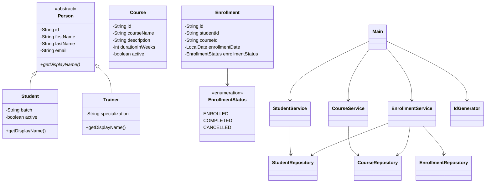

# LearnTrack — Student & Course Management System

## 1. Project Overview

LearnTrack is a console-based Student & Course Management System built using Core Java. It provides a menu-driven interface for managing students, courses, and course enrollments.

The project demonstrates fundamental Java programming concepts, object-oriented programming, collections, exception handling, and modular application design.

## 2. Features

### Student Management
- Add new students.
- View all students.
- Find students by ID.
- Update student details.
- Deactivate students without deleting their records.
- Validate required fields and email addresses.

### Course Management
- Add new courses.
- View all courses.
- Find courses by ID.
- Update course details.
- Activate and deactivate courses.
- Validate course information and ensure the course duration is greater than zero.

### Enrollment Management
- Enroll students in courses.
- View all enrollments.
- View enrollments for a specific student.
- Mark enrollments as completed.
- Cancel active enrollments.
- Prevent duplicate active enrollments.
- Prevent inactive students from enrolling.
- Prevent enrollment in inactive courses.
- Preserve enrollment history when an enrollment is completed or cancelled.
- Reject invalid enrollment status transitions.

## 3. Technology Stack

- **Language:** Java
- **Collections:** `ArrayList`
- **Interface:** Console-based menu
- **Date handling:** `LocalDate`
- **Development environment:** IntelliJ IDEA
- **Build tool:** Java compiler (`javac`)

The application uses in-memory storage. It does not require a database, and its data is lost when the application terminates.

## 4. Project Structure

```text
learn-track/
├── src/
│   └── com/
│       └── airtribe/
│           └── learntrack/
│               ├── Main.java
│               ├── entity/
│               │   ├── Person.java
│               │   ├── Student.java
│               │   ├── Trainer.java
│               │   ├── Course.java
│               │   └── Enrollment.java
│               ├── enums/
│               │   └── EnrollmentStatus.java
│               ├── exception/
│               │   ├── EntityNotFoundException.java
│               │   └── InvalidInputException.java
│               ├── repository/
│               │   ├── StudentRepository.java
│               │   ├── CourseRepository.java
│               │   └── EnrollmentRepository.java
│               ├── service/
│               │   ├── StudentService.java
│               │   ├── CourseService.java
│               │   └── EnrollmentService.java
│               └── util/
│                   └── IdGenerator.java
├── docs/
│   ├── Setup_Instructions.md
│   ├── JVM_Basics.md
│   └── Design_Notes.md
├── .gitignore
└── README.md
```

## 5. Application Architecture

LearnTrack separates user interaction, business logic, and data access into distinct responsibilities.

- **Entity layer:** Represents application objects, including students, courses, enrollments, and shared person information.
- **Repository layer:** Stores and retrieves entities using in-memory `ArrayList` collections.
- **Service layer:** Implements business rules, validates inputs, and coordinates operations between repositories.
- **UI layer:** `Main.java` provides the menu-driven interface, accepts user input, invokes services, and displays results.
- **Utility layer:** `IdGenerator` provides static methods for generating entity IDs.
- **Exception layer:** Defines `EntityNotFoundException` and `InvalidInputException` for application errors.
- **Enum layer:** `EnrollmentStatus` represents the available enrollment states: `ENROLLED`, `COMPLETED`, and `CANCELLED`.

## 6. Class Diagram



## 7. Prerequisites

- A Java Development Kit (JDK) installed on your machine.
- IntelliJ IDEA or another Java-compatible IDE, if preferred.
- A terminal or command prompt for compiling and running the application.

Verify that Java is installed:

```bash
java -version
javac -version
```

Both commands should execute successfully. If either command is unavailable, configure your JDK installation and system `PATH`.

For detailed setup instructions, see [`docs/Setup_Instructions.md`](docs/Setup_Instructions.md).

## 8. How to Compile and Run

Run these commands from the project root directory.

### Windows PowerShell

Compile all Java source files into the `out` directory:

```powershell
New-Item -ItemType Directory -Force out | Out-Null

javac -d out `
    (Get-ChildItem .\src -Recurse -Filter *.java |
     ForEach-Object { $_.FullName })
```

If compilation succeeds, launch the application:

```powershell
java -cp out com.airtribe.learntrack.Main
```

### IntelliJ IDEA

1. Open the LearnTrack project.
2. Configure the project SDK to use an installed JDK.
3. Locate `src/com/airtribe/learntrack/Main.java`.
4. Run the `main()` method.
5. Interact with the application through the console.

## 9. Documentation

The `docs/` directory contains additional learning and project documentation.

| File | Description |
|---|---|
| `Setup_Instructions.md` | JDK setup, compilation, and execution instructions. |
| `JVM_Basics.md` | JDK, JRE, JVM, bytecode, and platform independence. |
| `Design_Notes.md` | Design decisions, `ArrayList` versus arrays, static members, and inheritance. |

## 10. Limitations

- Data is stored in memory and is not retained after application termination.
- The application uses a console-based interface.
- There is no database integration.
- Authentication and authorization are outside the current project scope.
- ID counters reset when the application restarts.

## 11. Learning Objectives

Through this project, the following Core Java concepts are applied in a practical context:

- Java syntax, packages, and classes.
- Objects, constructors, and constructor overloading.
- Encapsulation through private fields and public accessors.
- Inheritance, abstract classes, and method overriding.
- Static and instance members.
- `ArrayList` and collections of objects.
- Enums and `LocalDate`.
- Input validation and custom exceptions.
- Service and repository separation.
- Business-rule enforcement and state transitions.
- Modular design and separation of concerns.

## 12. Future Improvements

Potential extensions for LearnTrack include:

- Persisting students, courses, and enrollments using a database.
- Adding automated unit tests for service-layer business rules.
- Improving console input handling and validation.
- Introducing a graphical or web-based user interface.
- Adding reporting features for student enrollments and course completion.